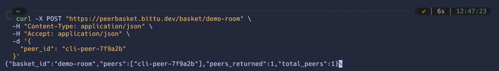

<div align="center">


# PeerBasket

### A hassle-free, lobby-based PeerJS discovery server.


[](https://peerbasket.bittu.dev/)
[](https://discord.gg/CZdNvKaNNr)
[](https://peerbasket.bittu.dev)

</div>

## How It Works

- WebRTC enables browsers to connect directly, but they need to exchange Peer IDs first.
- PeerBasket acts as a zero-config discovery lobby
- Send a `POST` request with your `peer_id` under a shared room name (a basket).
- The server responds with the list of other active Peer IDs currently in that basket.
- Connect directly to everyone returned using [PeerJS](https://peerjs.com/).
- Inactive peer heartbeats are automatically pruned after **30 seconds**.

## Quickstart

Register your Peer ID and fetch active peers in a room with a single request:

```javascript
const response = await fetch('https://peerbasket.bittu.dev/basket/my-room', {
  method: 'POST',
  headers: { 'Content-Type': 'application/json' },
  body: JSON.stringify({ peer_id: 'my-peerjs-id' })
});
const { peers } = await response.json();

// Connect to everyone else in the room
peers
  .filter(id => id !== 'my-peerjs-id')
  .forEach(id => peer.connect(id));
```

> [!TIP]
> Poll this endpoint every 10 seconds to maintain your heartbeat and discover incoming peers.

## Examples

Ready-to-run interactive examples are in the [examples](./examples) directory:

- **[1:1 Matchmaker Chat](./examples/01-matchmaker-chat/index.html)** — Matches random peers and halts polling once connected.
- **[P2P File Drop](./examples/02-local-file-drop/index.html)** — Direct browser-to-browser file transfer over data channels.
- **[Group Video Room](./examples/03-group-video-chat/index.html)** — Multi-user video calls with dynamic peer discovery and pruning.

## CLI Showcase

<div align="center">



</div>

## Run Locally

Requires **Redis** (running locally or accessible via `REDIS_ADDR`).

```bash
# Clone the repository
git clone https://github.com/Bittu5134/PeerBasket.git && cd PeerBasket

# Run the server
go run .
```

- `PORT` (default `8080`)
- `REDIS_ADDR` (default `localhost:6379`)
- `GIN_MODE`

> [!NOTE]
> Pre-compiled binaries for Linux, macOS, and Windows are also available on the [Releases](https://github.com/Bittu5134/PeerBasket/releases) page.

## Built Using

[Go](https://go.dev) · [Gin](https://github.com/gin-gonic/gin) · [Redis](https://redis.io) · [PeerJS](https://peerjs.com)
